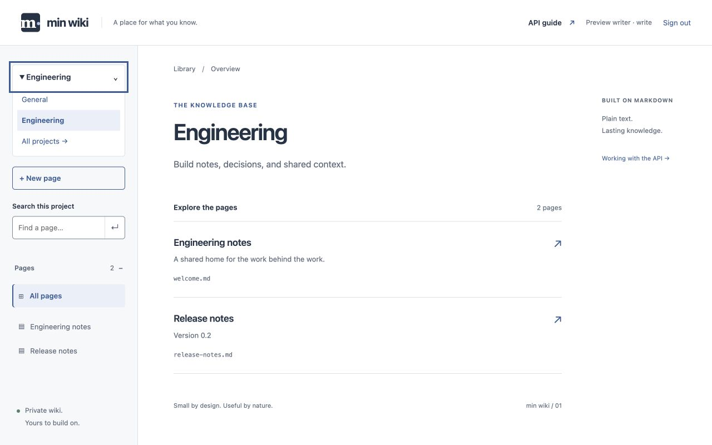

# min wiki

A small Node.js wiki. Pages are ordinary Markdown files, reading can be public or private, and pages can be managed through the browser or an authenticated HTTP API. Includes search, heading outlines, raw Markdown export, read/write/admin keys, and conditional writes to prevent accidental overwrites.



## What it does

- Renders Markdown with readable typography, tables, code blocks, section links, and responsive navigation.
- Searches titles and page content, with no database or indexing service.
- Creates, updates, deletes, and exports pages over HTTP, including direct Markdown file uploads.
- Issues named read/write/admin access keys, stores only their hashes, and supports immediate revocation for new requests.
- Supports Cognito managed login with write access for every signed-in user and an optional admin group.
- Organizes pages into projects with shared wiki permissions and independent page slugs.
- Requires the current ETag when updating or deleting a page to protect against conflicting edits.

The reader is server-rendered and works without JavaScript. The service uses Express, markdown-it, and AWS’s JWT verifier, with no frontend build step. This is a small, single-process wiki; per-project permissions, attachments, and revision history are outside the current scope.

## Run locally

Requires Node.js 24 or newer and npm.

```sh
git clone https://github.com/p2dev/min-wiki.git
cd min-wiki
npm ci
npm run init
npm start
```

`init` adds starter pages and prints a randomly generated admin key **once**. Save it in your password manager. No default key exists. Open [the wiki](http://127.0.0.1:3000) or [the API guide](http://127.0.0.1:3000/guide).

Use the admin API to issue a separate `write` key for each client. Never put keys in source files, page content, URLs or browser storage. Public mode permits anonymous reading. For private mode, set `WIKI_VISIBILITY=private`; users can sign in with a wiki key or your configured Cognito pool.

```sh
# Run the verification suite
npm test
npm run check

# Restart automatically during development
npm run dev
```

## Configuration

| Environment variable | Default | Purpose |
| --- | --- | --- |
| `HOST` | `127.0.0.1` | Listening interface |
| `PORT` | `3000` | HTTP port |
| `WIKI_VISIBILITY` | `public` | `public` or `private` for all projects and content routes |
| `PUBLIC_URL` | `http://127.0.0.1:3000` (uses `PORT`) | External origin; set explicitly for Cognito/proxy deployments |
| `COGNITO_USER_POOL_ID` | Unset | Existing Cognito User Pool ID |
| `COGNITO_CLIENT_ID` | Unset | Allowed app-client ID |
| `COGNITO_DOMAIN` | Unset | Managed-login HTTPS origin |
| `COGNITO_CLIENT_SECRET` | Unset | Optional confidential app-client secret |
| `COGNITO_ADMIN_GROUP` | Unset | Exact group granting wiki admin permissions |
| `DATA_DIR` | `data/` in this project | Absolute or working-directory-relative storage directory |

For example, `DATA_DIR=/path/to/wiki-data PORT=4000 npm start`. Use the same `DATA_DIR` for initialization, key recovery, and serving. Environment variables are read directly; `.env` files are not automatically loaded.

See [.env.example](.env.example) and the [Cognito setup guide](docs/authentication.md) for the complete setup. Every signed-in Cognito user can edit every project; control user enrollment in your User Pool.

The server can start with an empty directory for an empty wiki. Run `init` while stopped to add starter content and an admin, or `key:create` to create an admin without starter pages.

## API

See [the complete API guide](docs/api.md) for request/response formats, curl examples, errors, key rotation, and direct Markdown uploads.

| Operation | Endpoint |
| --- | --- |
| List/search | `GET /api/pages?q=term` |
| Read page / source | `GET /api/pages/:slug` / `GET /api/pages/:slug/raw` |
| Create | `POST /api/pages` with `{ "slug", "markdown" }` |
| Upload new file | `PUT /api/pages/:slug`, `If-None-Match: *`, `text/markdown` body |
| Update | `PUT /api/pages/:slug`, exact `If-Match` ETag |
| Delete | `DELETE /api/pages/:slug`, exact `If-Match` ETag |
| Manage keys | `GET/POST /api/keys`, `DELETE /api/keys/:id` (admin) |

API mutations require `Authorization: Bearer <key-or-Cognito-access-token>`. Private-mode reads also require a credential. Only administrators can manage keys and projects. Browser session cookies do not authorize API calls. Only hashes of generated secrets are stored; key secrets cannot be retrieved later.

## Files and recovery

```text
data/
  pages/          # General project: canonical <slug>.md files
  projects/       # Additional project directories containing Markdown
  projects.json   # Project names and descriptions
  keys.json       # Private key hashes and metadata; never served
  .lock           # Present while the service or CLI owns this directory
```

The first H1 heading becomes the display title. Supported filenames are lowercase letters/digits separated by single hyphens, up to 100 characters. A page is limited to 256 KiB. No frontmatter is required. Markdown HTML is escaped; local `page-slug.md` links resolve to rendered wiki pages. There is no attachment endpoint or revision history.

Run **one service process per data directory**, on a local filesystem. The server serializes API writes and replaces files atomically; a data-directory lock prevents concurrent server/CLI use. Do not edit files externally while API writes are in progress. Direct filesystem edits are visible on the next read, without reindexing. Invalid filenames and symlinks are not listed or served.

If a crash leaves `.lock`, startup explains its location and PID. Verify that no service or CLI process owns that directory, then remove the stale lock and restart. Locks are never automatically removed during startup, avoiding competing recovery processes taking ownership at the same time.

To back up, stop the service and copy the entire data directory to a protected location. Restore it while the service is stopped. Delete any copied `.lock` only after verifying no process is using the restored directory. Protect the backup because it contains wiki content and private key metadata. Test restoration before relying on a backup process.

To recover lost admin access, stop the server and run `npm run key:create -- "Recovery administrator"`. Save the new key, restart, and revoke lost keys using the API. Never print or paste key registry contents into public logs.

## Deployment boundary

The MVP is verified locally; this repository does not provision hosting. For hosting, run under a process supervisor, keep `DATA_DIR` on persistent local disk, and terminate HTTPS at a reverse proxy. Bind to an appropriate interface only when needed. Configure network request-rate limits and monitoring at the proxy for an internet-facing service. Run as an unprivileged user; filesystem access is administrative access. No TLS, multi-instance shared storage, automatic backups, or distributed search is built in. See [operations](docs/operations.md) for startup, upgrades, backups, and recovery.

Search scans the collection and renders metadata on each request; this is intended for a small wiki. Revisit indexing only when measured usage warrants it.

## Documentation

- [API reference and examples](docs/api.md)
- [Private access and Cognito configuration](docs/authentication.md)
- [Projects, browser editing, and compatibility](docs/projects.md)
- [Operations and recovery](docs/operations.md)
- [Architecture comparison and UX/design decisions](docs/architecture.md)
- [MVP status and acceptance evidence](ROADMAP.md)
- [Contributing and development](CONTRIBUTING.md)
- [Security model and reporting](SECURITY.md)
